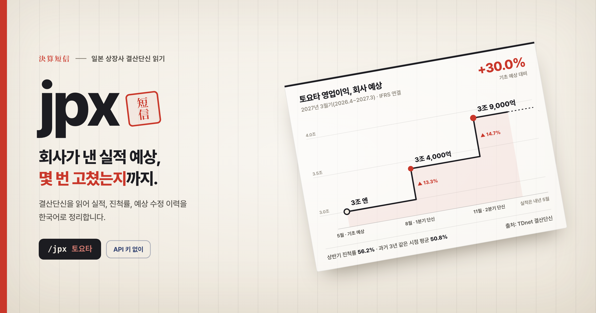

# jpx



> 일본 상장사 이름만 말하면, 그 회사가 결산단신에 직접 낸 실적과 연간 예상을 정리해 드립니다. 회사가 그 예상을 어떻게 지켜 왔는지도 숫자로 보여 드립니다.

[](LICENSE) · Prototype 0.2 · API 키가 필요 없습니다

---

## 누가 쓰면 좋은가

- 일본 기업과 거래하거나 경쟁하면서 상대 회사의 분기 실적을 빨리 파악해야 하는 경영진
- 일본 주식을 처음 사 보려는 개인 투자자
- 일본 종목을 맡아 진척률과 가이던스 수정 이력을 매 분기 정리하는 애널리스트

일본어를 몰라도 됩니다. 한국어로 묻고, 한국어로 답을 받습니다.

## 무엇을 해 주나

"닌텐도 2분기 어때?"라고 물으면 이런 답이 나옵니다. 아래 숫자는 2026년 11월 5일 공시된 실제 결산단신에서 뽑았습니다.

> **닌텐도(7974), 2027년 3월기 상반기(2026년 4~9월, 6개월 누적)**
> 매출은 12.1% 줄었지만 영업이익은 49.1% 늘었습니다. 회사는 연간 예상을 바꾸지 않았습니다.
>
> | 항목 | 상반기 누적 | 전년 대비 | 연간 회사 예상 | 진척률 (과거 3년 평균) |
> |---|---|---|---|---|
> | 매출 | 9,660억 엔 | -12.1% | 2조 500억 엔 | 47.1% (46.7%) |
> | 영업이익 | 2,165억 엔 | +49.1% | 3,700억 엔 | 58.5% (45.4%) |
>
> 예상을 그대로 두면 하반기 영업이익은 1,535억 엔으로 전년 하반기보다 28.6% 적어야 합니다. 영업이익 기준 기초 예상 달성률은 최근 3년 113%, 71%, 118%로 해마다 달랐습니다.

질문에 따라 답의 초점이 달라집니다.

| 이렇게 물으면 | 이런 숫자를 받습니다 |
|---|---|
| "토요타 이번 분기 어땠어?" | 누적 실적과 3개월 실적, 전년 대비, 연간 예상과 이번 분기 수정 여부, 배당, 자사주, 같은 날 나온 공시, 회사가 직접 쓴 증감 요인 |
| "소니 가이던스 올렸어?" | 기초 예상부터 분기별 수정, 예상 수정 공시, 실적까지 이어진 이력과 단계별 수정폭 |
| "도쿄일렉트론 진척률 어때?" | 이번 진척률, 과거 같은 분기 진척률, 남은 기간에 회사가 암묵적으로 가정한 실적 |
| "닌텐도 분기별 추이 보여줘" | 최근 회계연도의 3개월 실적 시계열과 전년 같은 분기 대비 |
| "미쓰비시UFJ PBR 얼마야" | 예상 PER, PBR, 배당수익률, 시가총액, 100주 최소 매수 금액, 최근 ROE |
| "미쓰비시상사 최근 공시 뭐 있어?" | 결산단신, 예상 수정, 배당, 자사주, 공개매수 같은 적시공시 목록과 원문 링크 |

토요타의 연간 영업이익 예상은 이렇게 이어서 보여 드립니다(2026년 실측).

| 시점 | 영업이익 예상 | 직전 대비 |
|---|---|---|
| 5월, 기초 예상 | 3조 엔 | |
| 8월, 1분기 결산단신 | 3조 4,000억 엔 | 상향 |
| 11월, 2분기 결산단신 | 3조 9,000억 엔 | 상향 |

## 왜 따로 만들었나

일본 공시는 한국이나 미국과 구조가 다릅니다. DART나 EDGAR 스킬을 이름만 바꿔 쓰면 틀린 숫자가 나옵니다.

| | 한국 | 미국 | 일본 |
|---|---|---|---|
| 가장 빠른 실적 | 잠정실적 공시 | 8-K 보도자료 | 결산단신(決算短信). 거래소는 결산 후 45일 안에 내도록 권고합니다 |
| 1·3분기 실적 | 분기보고서 | 10-Q | 2024년 4월 분기보고서가 폐지되어 결산단신에만 있습니다 |
| 분기 숫자 | 3개월치와 누적 | 3개월치와 누적 | 누적만 공시합니다. 3개월치는 빼서 구해야 합니다 |
| 회사의 실적 예상 | 드뭅니다 | 실적 발표 때 말로 | 거의 모든 회사가 연간 예상을 공시하고, 바뀌면 수정 공시를 냅니다 |
| 이익 단계 | 영업이익 | Operating income | 일본 기준은 경상이익(経常利益)이 핵심입니다. IFRS·미국 기준 회사에는 없습니다 |
| 원문 보관 | 영구 | 영구 | 적시공시 사이트 TDnet은 약 한 달 뒤 파일을 지웁니다 |

GitHub에는 일본 공시를 다루는 도구가 이미 여럿 있습니다(edinet-mcp, EDINET DB, dexter-jp 등). 재무제표 정규화, 대량보유 조회, 종목 스크리닝은 이미 흔합니다. 그러나 **기초 예상에서 수정을 거쳐 실적까지 이어지는 예상 이력을 추적하고, 회사별 과거 같은 시점 진척률과 기초 예상 달성률을 계산하는 도구**는 2026년 11월 조사 시점에 찾지 못했습니다. 한국어로 답하는 도구도 없었습니다. 이 스킬은 그 빈자리를 채웁니다.

## 믿을 수 있나

**숫자는 공시 원문에서만 꺼냅니다.** 모든 실적은 회사가 거래소에 낸 결산단신 XBRL(기계가 읽는 공시 파일)에서 나옵니다. 금액은 공시 표와 같은 백만 엔 단위로 받고, 한국어 표기(9,660억 엔)를 함께 붙입니다.

**계산한 숫자는 계산값이라고 표시합니다.** 진척률, 3개월 실적, 남은 기간 암묵 예상, PER처럼 문서 두 개 이상이나 주가를 써서 만든 숫자에는 `derived` 표시와 입력 문서 목록이 붙습니다.

**계산할 수 없으면 숫자를 만들지 않습니다.** 회계기준이 다른 두 단신을 빼야 하거나, 회사가 예상을 내지 않았거나, 사업 분리로 전년 숫자의 기준이 바뀌었으면 계산하지 않고 이유를 남깁니다.

**과거 단신이 사라져도 이력이 끊기지 않습니다.** TDnet은 한 달 뒤 파일을 지우지만, 일본거래소그룹(JPX) 사이트에는 같은 파일의 사본이 수년 동안 남아 있습니다(2017년 파일까지 확인). 이 스킬은 사본에서 과거 단신을 받고, 받은 파일의 원본과 해시값을 함께 사용자 컴퓨터의 보관함에 쌓아 둡니다. 쓸수록 이력이 쌓입니다.

| 데이터 | 출처 | 비고 |
|---|---|---|
| 결산단신·예상 수정 XBRL과 PDF | JPX 사본 `www2.jpx.co.jp/disc`, 없으면 TDnet | 공식 공시 원문 |
| 회사별 공시 목록 | webapi.yanoshin.jp | 비공식 색인입니다. 멈추면 캐시와 보관함으로 답하고, 그렇다고 알립니다 |
| 상장사 목록 | 금융청 EDINET 코드 목록 | 3,814곳. 번들로 들어 있고 30일마다 새로 받습니다 |
| 주가 | Yahoo 차트 | 비공식이라 참고용입니다. 직전 거래일 종가만 쓰고, 단신 이후 주식분할이 있으면 PER·PBR을 내지 않습니다 |

### 실측 기록 (2026-11-06)

세 가지 회계기준과 업종별 예외를 실제 단신으로 확인했습니다.

| 회계기준 | 회사 |
|---|---|
| 일본 기준(J-GAAP) | 닌텐도, 미쓰비시UFJ(은행) |
| IFRS | 토요타, 소니, 미쓰비시상사(상사), 도쿄해상(손해보험) |
| 미국 기준(US GAAP) | 캐논(12월 결산), 노무라(예상 비공개) |

실측 과정에서 찾아 고친 문제는 다음과 같습니다. 모두 회귀 테스트에 들어 있습니다.

- 캐논은 같은 분기 단신을 감사인 검토 완료 뒤 한 번 더 냅니다. 두 번째 판은 "이번 분기 예상 수정 없음"으로 표시되어, 이 판을 고르면 수정 사실을 놓칩니다. 지금은 처음 낸 판을 정본으로 씁니다.
- 미쓰비시UFJ의 정정 공시 파일에는 요약 없이 고친 재무제표만 들어 있었습니다. 이 파일을 정본으로 고르자 한 분기가 통째로 빠졌습니다. 지금은 원본 요약으로 돌아가고, 정정이 있었다는 사실을 함께 알립니다.
- 소니는 금융 사업 분리로 과거 숫자의 기준이 바뀌었습니다. 지금은 해마다 다음 해 단신이 고쳐 실은 전년 값과 대조하고, 기준이 끊긴 해를 평균에서 뺍니다.
- 소니 첨부 재무제표에는 지분법손익이 3개월치와 누적 두 가지로 실려 있었습니다. 지금은 누적을 먼저 고릅니다.
- 닌텐도는 환차익과 환차손이 해마다 다른 칸에 실립니다. 지금은 둘을 합친 순액으로 봅니다.
- 미쓰비시상사는 자사주 취득 현금을 순액 항목으로만 싣습니다. 지금은 그 항목도 읽습니다.

검증은 두 단계로 했습니다. 먼저 수행자 에이전트가 SKILL.md만 보고 애널리스트·임원·개인 투자자의 질문에 답했습니다. 이어서 평가 에이전트가 그 답의 숫자 82개를 도구 출력과 대조했고, 그중 미쓰비시상사의 숫자 10개는 원본 XBRL과도 직접 맞춰 보았습니다. 반올림 표기 한 곳을 빼면 옮겨 적은 숫자는 모두 맞았습니다. 대신 도구 쪽 결함 네 가지(소니 지분법 기간 혼동, 기준 변경 미전파, 회사 설명 누락, 은행 목표 미계산)가 드러났고, 모두 코드로 고친 뒤 다시 평가받았습니다. 4역할 평가 평균은 8.1점에서 8.9점으로 올랐습니다.

## 쓰는 법

준비물은 Python 3.9 이상뿐입니다. API 키도, 추가 패키지도 필요 없습니다(`requests`가 깔려 있으면 그것을 씁니다).

### 방법 A. 터미널에서 설치

저장소를 Claude 스킬 폴더로 내려받습니다.

```bash
git clone https://github.com/airoasting/jpx ~/.claude/skills/jpx
```

아래 명령이 닌텐도의 최신 결산단신을 보여 주면 준비가 끝난 것입니다.

```bash
python3 ~/.claude/skills/jpx/assets/mcp_server.py --call fin_tanshin '{"company": "닌텐도"}'
```

### 방법 B. Claude Desktop에서 말로 설치

Claude Desktop 대화창에 아래 문장을 붙여 넣으면 Claude가 저장소를 내려받고 확인 명령까지 실행합니다. API 키를 받을 필요는 없습니다.

```
아래 스킬을 설치해줘.
- 저장소: https://github.com/airoasting/jpx
- 설치 위치: ~/.claude/skills/jpx (git clone)
- 설치 뒤 닌텐도 결산단신 조회로 확인까지 해줘
```

> Claude가 파일과 터미널에 접근할 수 있어야 실제로 실행됩니다. 권한이 없으면 방법 A의 단계를 안내합니다.

### 부르는 법

Claude Code나 Claude Desktop에서 이렇게 부릅니다.

```
/jpx 닌텐도
토요타 2분기 실적 어때?
소니 가이던스 수정 이력 정리해줘
미쓰비시상사 주주환원은 얼마나 해?
7203 분기별 3개월 실적
```

회사 이름은 한국어(토요타, 도요타, 유니클로), 영어, 일본어, 증권코드(7203, 285A) 모두 받습니다. 153개 회사의 한국어 별칭을 넣어 두었습니다. "유니클로"처럼 브랜드로 물으면 운영사인 패스트리테일링으로 연결하고 그 사실을 밝힙니다. "미쓰비시"처럼 계열사가 여럿이면 추측하지 않고 후보를 보여 드립니다.

가이던스 이력은 처음 물을 때 과거 단신 10~20개를 받느라 30초 안팎 걸립니다. 받은 파일은 보관함에 남아 두 번째부터는 몇 초면 됩니다.

### MCP 도구로 연결하기

스킬로 설치했다면 따로 연결하지 않아도 됩니다. 스킬 없이 MCP 도구만 쓰고 싶다면 Claude Code에서 한 줄로 등록합니다.

```bash
claude mcp add --scope user jpx -- python3 ~/.claude/skills/jpx/assets/mcp_server.py
```

Claude Desktop에서는 설정 파일(`claude_desktop_config.json`)에 아래를 넣고 앱을 다시 켭니다. Desktop은 `~`를 홈 경로로 바꾸지 않으므로 전체 경로를 씁니다.

```json
{
  "mcpServers": {
    "jpx": {
      "command": "python3",
      "args": ["/Users/사용자이름/.claude/skills/jpx/assets/mcp_server.py"]
    }
  }
}
```

플러그인으로 설치했다면 `.claude-plugin/plugin.json`에 서버가 등록돼 있어 함께 켜집니다.

### 도구 목록 (6개)

| 도구 | 하는 일 |
|---|---|
| `company_resolve` | 회사 이름이나 코드를 상장사 하나로 정합니다. 애매하면 후보를 돌려줍니다 |
| `filing_search` | 적시공시 목록을 종류별로 돌려줍니다 |
| `fin_tanshin` | 결산단신 한 장을 읽습니다. 실적 질문의 기본 도구입니다 |
| `fin_guidance` | 한 회계연도의 예상 이력, 진척률 기준선, 남은 기간 암묵 예상, 기초 예상 달성률을 계산합니다 |
| `fin_quarters` | 누적끼리 빼서 3개월 실적 시계열을 만듭니다 |
| `market_valuation` | 직전 종가와 최신 단신으로 PER, PBR, 배당수익률을 계산합니다 |

터미널에서 목록과 도구별 설명을 볼 수 있습니다.

```bash
python3 ~/.claude/skills/jpx/assets/mcp_server.py --list
```

## 답을 읽을 때 알아 두면 좋은 것

- **"2027년 3월기"는 2026년 4월부터 2027년 3월까지입니다.** 답에는 항상 실제 기간을 함께 적습니다.
- **회사 예상은 증권사 컨센서스가 아닙니다.** 회사가 직접 낸 전망입니다. 컨센서스는 공시에 없으므로, 이 스킬은 "시장 기대를 넘었다"는 말을 하지 않습니다.
- **진척률이 낮다고 부진한 것은 아닙니다.** 일본 회사 중에는 예상을 낮게 잡고 나중에 올리는 곳이 있고, 하반기에 실적이 몰리는 업종도 있습니다. 그래서 진척률은 항상 그 회사의 과거 같은 시점과 나란히 보여 드립니다.
- **PBR 1배 미만이 곧 저평가는 아닙니다.** 수익성(ROE)이 낮아서 그렇게 매겨졌을 수 있습니다. PBR은 항상 ROE와 함께 보여 드립니다.
- **원화 환산은 하지 않습니다.** 믿을 만한 환율 소스를 붙이지 않았기 때문입니다.

일본 공시 용어와 한국 용어의 대응은 [references/glossary.md](references/glossary.md)에 정리해 두었습니다.

## 하지 않는 것

- 매수·매도 추천, 목표주가, 여러 종목 스크리닝
- 유가증권보고서 본문(정책보유주식, 임원 보수)과 대량보유보고서 분석. EDINET API 키가 필요해 다음 버전 후보로 두었습니다
- 결산 설명 자료 PDF 안의 KPI(가정 환율, 판매 대수, 부문별 실적)

## 작동 방식 (기술 참고)

```
SKILL.md                 Claude가 따르는 규칙(읽기 규칙 9개, 답 모양)
docs/DESIGN.md           설계 기록과 다섯 관점(GitHub 조사, 멍거, SILVER, RED, BLUE·GOLD) 검토 결과
references/glossary.md   일본 공시 용어와 DART 용어 대응표
assets/mcp_server.py     MCP 서버와 도구 6개
assets/analysis.py       예상 이력, 진척률 기준선, 3개월 분리, 기준 변경 감지, 목표 문구 해석
assets/ixbrl.py          TDnet 인라인 XBRL 파서와 회사 설명 추출
assets/jpx_client.py     공시 색인, JPX 사본, 보관함, 상장사 목록, 주가
assets/jp_companies.csv  상장사 목록 번들
assets/jp_aliases.csv    한국어 별칭 153곳
assets/thumbnail.html    README 썸네일 원본(토요타 예상 수정 이력 실측값). 고치면 thumbnail.png를 다시 찍는다
evals/                   스킬 발동 점검용 질문 14개
tests/                   회귀 테스트 28개와 실제 XBRL 파일 3개
```

- 표준 라이브러리만으로 돌아갑니다.
- 보관함 위치는 `~/.claude/skills/jpx/vault/{증권코드}/`입니다. 파일은 추가만 하고 덮어쓰지 않습니다. 파서가 바뀌면 보관한 원본에서 다시 읽습니다.
- 테스트는 네트워크 없이 돌아갑니다.

```bash
python3 -m unittest discover -s tests -v
```

## 고치는 기준과 멈추는 기준

- 원문과 다른 숫자가 하나라도 나오면 해당 회계기준이나 업종을 고칠 때까지 SKILL.md에서 그 범위를 막습니다.
- 비공식 공시 색인이 석 달 넘게 멈추면 TDnet 일자별 목록으로 색인을 대신하거나, 사용자 각자의 키로 쓰는 공식 소스(J-Quants)로 옮깁니다.
- JPX 사본 경로가 바뀌어 과거 단신을 받지 못하게 되면 예상 이력 기능을 보관함에 있는 범위로 줄입니다.
- 도구 출력 모양이 바뀌면 SKILL.md 3·4절과 이 README의 도구 표를 함께 고칩니다.

## 다음 단계 후보

1. EDINET API 연결: 정책보유주식 축소 추이와 대량보유보고서의 보유 목적 변화를 더해, 도쿄증권거래소의 "자본비용과 주가를 의식한 경영" 요청에 대한 회사별 대응을 숫자로 봅니다.
2. DART 스킬처럼 한 장짜리 HTML 리포트
3. 자사주 취득 결정 공시에서 한도 금액과 주식 수 읽기
4. 다음 결산 발표 예정일 안내

## 라이선스

[MIT](LICENSE) © airoasting

## 면책 고지

이 스킬의 답은 공개된 공시 데이터를 바탕으로 한 참고 자료입니다. 투자를 권유하지 않으며, 최종 투자 판단과 그에 따른 손익의 책임은 투자자 본인에게 있습니다. 주가는 비공식 소스에서 받은 참고값입니다.
